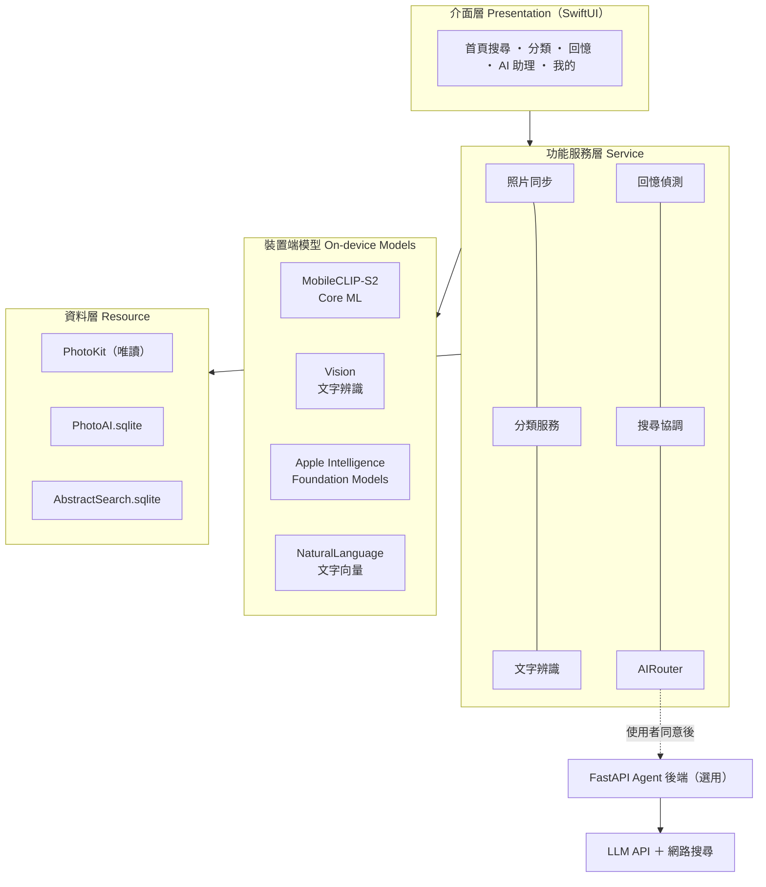
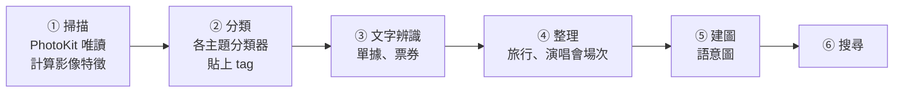
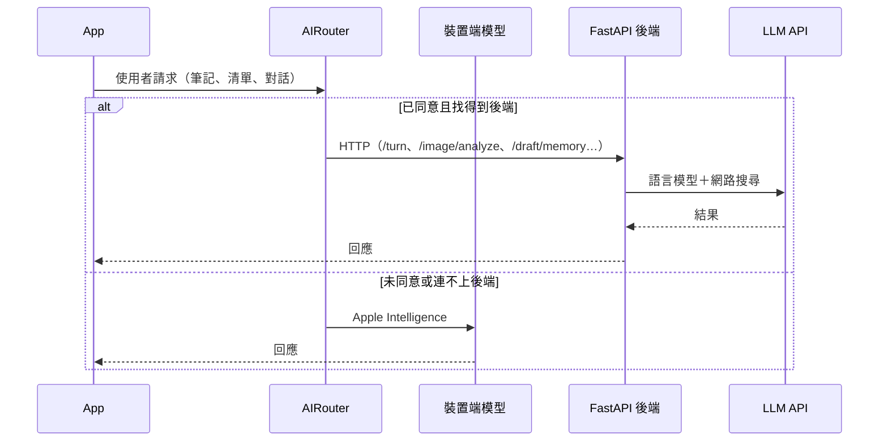

<div align="center">

# selfIE 智慧相簿管理系統

**Adaptive Personal Visual Memory System**

自動整理你／妳拍下的瞬間


長庚大學 資訊工程學系 / 人工智慧學系 專題研究

</div>

---

## 目錄

1. [專案簡介](#1-專案簡介-introduction)
2. [核心功能](#2-核心功能-features)
3. [系統架構](#3-系統架構-architecture)
4. [實作方法](#4-實作方法-method)
5. [資料庫設計](#5-資料庫設計-database-design)
6. [訓練與測試資料](#6-訓練與測試資料-data)
7. [實驗結果](#7-實驗結果-results)
8. [專案結構](#8-專案結構-project-structure)
9. [開發與執行環境](#9-開發與執行環境-environment)
10. [安裝與執行](#10-安裝與執行-getting-started)
11. [測試方式](#11-測試方式-testing)
12. [隱私與安全設計](#12-隱私與安全設計-privacy)
13. [系統限制與未來工作](#13-系統限制與未來工作-limitations--future-work)
14. [參考文獻](#14-參考文獻-references)
15. [專題團隊](#15-專題團隊-project-team)
16. [授權條款](#16-授權條款-license)

---

## 1. 專案簡介 (Introduction)

### 1.1 研究動機

現代人習慣用手機記錄生活，相簿裡動輒累積上萬張照片，卻衍生出三個問題：

| 問題 | 說明 |
| --- | --- |
| **找不到** | 照片越多越難找，只能憑印象一路往回滑 |
| **認不出** | 內建相簿的分類偏向通用（人物、風景），分不出角色周邊、演唱會場次、票根、手帳等個人興趣 |
| **不想上傳** | 雲端相簿的辨識功能需先上傳照片，而照片是最私人的資料之一 |

### 1.2 研究目的

selfIE 是一款**在手機上完成分析**的 iOS 智慧相簿 App，目標是：

1. **一句話找照片**：以自然語言、日期、地點搜尋照片。
2. **自動分類整理**：自動分出主題、人像與單據，並支援使用者自訂的「我的 IP」相簿。
3. **把照片變成回憶與清單**：自動整理旅行與演唱會場次；AI 助理把照片整理成筆記、想去清單與購物清單。
4. **隱私優先**：照片不需上傳；App 以唯讀方式存取相簿，**不修改、移動或刪除任何原始照片與相簿**。

### 1.3 與現有相簿 App 的定位差異

| 面向 | 一般相簿 App | selfIE |
| --- | --- | --- |
| 小眾收藏（角色周邊、IP） | 無對應分類 | 挑幾張範例即可建立專屬相簿 |
| 演唱會 | 一般回憶 | 分場次，搭配地圖、票根的「追星足跡」 |
| 照片 → 清單 | 無 | 自動擷取想去的地點、想買的商品，去過自動打勾 |
| 分類調整 | 有限 | 使用者修正會成為下一版分類器的訓練資料 |

---

## 2. 核心功能 (Features)

| 編號 | 功能 | 說明 |
| --- | --- | --- |
| F1 | 照片掃描與特徵建立 | 在背景以 PhotoKit 唯讀讀取相簿，用 MobileCLIP-S2 為每張照片計算 512 維影像特徵；新照片自動補上，手機過熱時自動暫停 |
| F2 | 以文字搜尋照片與篩選 | 支援自然語言、日期（「2025年8月」「2025/8」）、地點的複合搜尋；縮圖會標示「找到的原因」（tag、照片文字、場景） |
| F3 | 自動主題分類 | 照片自動歸入 15 個大分類下的小分類（美食、展覽、演唱會、手帳…）；分錯可直接修正 |
| F4 | 人像判斷 | 「自拍」沿用 iPhone「照片」App 的自拍相簿；「人物照」由分類器判斷 |
| F5 | 單據與票券辨識 | 以文字辨識（OCR）分辨收據發票、登機證、菜單；電影票根歸入「電影」，演唱會票根補上演出名稱與座位 |
| F6 | 自動回憶相簿 | 依拍攝時間與地點整理旅行與演唱會場次；「追星足跡」以年份整理看過的演出、場館、城市，並在地圖上標示 |
| F7 | 專屬相簿（我的 IP） | 使用者挑幾張範例照片，系統依影像特徵與照片文字找出同一作品／角色的照片；可分「作品 → 角色」，名稱可直接搜尋 |
| F8 | AI 助理整理 | 回憶筆記草稿、想去清單（在當地拍照後自動打勾）、購物清單（日文、韓文、英文備註自動翻成中文） |
| F9 | 隱私與資料管理 | 只讀取、不修改照片；可移除 AI 分析資料；在系統相簿刪除的照片，分析資料同步清除 |
| F10 | 抽象語意搜尋 | 把照片轉成語意圖（主體、關係、場景與氛圍），處理「在海邊放鬆的下午」這類抽象描述 |

<!-- 建議在此放 App 截圖，例如：
<p align="center">
  
  
  
  
</p>
-->

---

## 3. 系統架構 (Architecture)

### 3.1 四層架構



| 層級 | 職責 |
| --- | --- |
| 介面層 | SwiftUI 五個分頁，接收使用者操作並呈現結果 |
| 功能服務層 | 照片同步、分類、文字辨識、回憶偵測、搜尋協調；`AIRouter` 決定 AI 功能走裝置端或後端 |
| 裝置端模型 | 影像特徵（MobileCLIP-S2）、文字辨識（Vision）、語言模型（Apple Intelligence）、文字向量（NaturalLanguage） |
| 資料層 | 以 PhotoKit 唯讀存取相簿；分析結果只寫入 App 自己的 SQLite 資料庫 |
| 選用後端 | FastAPI Agent，串接 LLM API 與網路搜尋；僅在使用者同意後啟用 |

### 3.2 照片處理流程



所有步驟皆在背景、於裝置上執行；裝置過熱時自動暫停。

### 3.3 AI 助理（Agent）整合



App 依序以「手動輸入的網址 → `Info.plist` 的 `AGENT_API_BASE_URL` → 區網 Bonjour（`_photoai-agent._tcp`）」尋找後端。

---

## 4. 實作方法 (Method)

### 4.1 影像特徵

使用 Apple 的 **MobileCLIP-S2**（Core ML），將照片與文字映射到同一個 512 維向量空間；內容相似的照片，向量也相近。特徵只計算一次並存入資料庫，後續分類與搜尋都重複使用，不需重新掃描。

### 4.2 主題分類

分類體系為三層、共 **180 個節點**：

```
15 個大分類 → 45 個中分類 → 120 個小分類
例：音樂與表演 → 現場演出 → 演唱會（音樂祭、Live House 併入演唱會）
```

分類方式經過兩個階段：

| 階段 | 做法 | 問題／改進 |
| --- | --- | --- |
| 初版 | 照片向量與文字描述（如 "a photo of a concert"）直接比對（zero-shot） | 不需訓練，但許多照片認不出來 |
| 現行 | 在影像特徵上，替每個主題訓練一個輕量分類器，分數超過門檻才貼 tag | 從真實照片學習；容易混淆的主題加入反例（例如展覽 vs. 演唱會） |

標記資料不足的小分類沒有分類器，維持文字比對。使用者在 App 內的修正會回饋為下一版的訓練資料。

### 4.3 搜尋

一般搜尋同時執行四種方法，再以 **Reciprocal Rank Fusion（RRF）** 依名次合併：

$$\text{score}(d) = \sum_{i} \frac{w_i}{60 + \text{rank}_i(d)}$$

| 方法 | 權重 $w_i$ |
| --- | --- |
| 照片向量（查詢與照片的 CLIP 相似度） | 1.0 |
| 照片上的文字（OCR 結果完全符合） | 1.0 |
| tag 與「我的 IP」名稱 | 0.8 |
| 抽象語意搜尋：有其他方法佐證／僅單獨找到 | 1.0／0.3 |

- 不同方法的分數尺度不同，RRF 只看名次，不需要換算分數；同時被多種方法找到的照片自然排在前面。
- 中文查詢會先翻譯成英文再與影像比對（翻譯結果會快取）；日期與地點條件另外篩選。
- 輸入注音組字中不會觸發自動搜尋，避免重複推論造成裝置發燙。

### 4.4 抽象語意搜尋（F10）

以 Apple Intelligence（Foundation Models）在裝置上把照片轉成**語意圖**（主體、關係、場景、氛圍），文字向量由 NaturalLanguage 產生，存入 `AbstractSearch.sqlite`。截圖、收據等文字型照片不建圖，直接使用 OCR 與分類結果。詳細說明見 [`MobileCLIPExplore/AbstractSearch/README.md`](MobileCLIPExplore/AbstractSearch/README.md)。

### 4.5 回憶與演唱會場次偵測

- **旅行**：自動學習常去地點（住家、學校、公司）並排除，將離開常住地的連續照片整理成一趟旅行。
- **演唱會**：以使用者**自己拍攝**的舞台照作為場次起點；截圖與下載的他人照片不作為起點，避免誤認。展覽、博物館、漫畫展等相似場景也不會被當成演唱會。
- **追星足跡**：依年份統計場次、場館與城市，並從票根照片的文字補上演出名稱與座位。

---

## 5. 資料庫設計 (Database Design)

系統使用兩個存放於 App 沙盒內的 SQLite 資料庫。所有資料表都只存照片的識別碼（`PHAsset.localIdentifier`），**不複製、不修改照片本身**。

### 5.1 PhotoAI.sqlite（主資料庫）

| 類別 | 資料表 | 用途 |
| --- | --- | --- |
| 照片特徵 | `PhotoFeatures` | 照片識別碼、拍攝詮釋資料、512 維影像向量、最愛旗標 |
| | `PhotoAnalysisState` | 每張照片的分析狀態與分類器版本 |
| | `PhotoText` | 文字辨識結果（原文與正規化文字） |
| | `PhotoFaces` | 人像相關資訊 |
| 分類 | `TaxonomyNodes`、`TaxonomyPrompts` | 三層分類體系與各分類的文字描述 |
| | `PhotoTags` | 照片與分類的對應：分數、來源（自動／手動）、狀態（確認／待確認／拒絕） |
| | `UserCustomCategories` | 使用者自訂分類（我的 IP） |
| 使用者 | `UserProfiles`、`UserInterests`、`UserCategoryPreferences`、`PinnedCategories` | 使用者興趣與分類偏好 |
| 相簿 | `UserAlbums`、`UserAlbumPhotos` | 使用者在 App 內建立的相簿 |
| AI 助理 | `AgentConversations`、`AgentMessages`、`AgentNotes` | 對話紀錄與筆記 |
| | `WikiNotes`、`WikiNotePhotos` | 回憶筆記知識庫（含文字向量） |
| | `WishPlaces` | 想去清單（狀態：想去／去過） |
| | `ShoppingItems` | 購物清單（狀態：想買／已買） |
| 其他 | `GeoRegionCache` | 地點反查快取 |
| | `PersonalizationMigrations`、`PersonalizationMeta` | 資料庫版本紀錄 |

**`PhotoTags` 範例結構**

| 欄位 | 型別 | 說明 |
| --- | --- | --- |
| `user_id` | TEXT | 使用者（複合主鍵） |
| `asset_id` | TEXT | 照片識別碼（複合主鍵） |
| `node_id` | TEXT | 分類節點（複合主鍵） |
| `score` | REAL | 分類器分數 |
| `source` | TEXT | `auto`／`manual` |
| `status` | TEXT | `accepted`／`candidate`／`rejected` |
| `tagger_version` | TEXT | 產生此 tag 的分類器版本 |

**資料庫升級原則**：App 啟動時自動執行 migration，每個版本在 transaction 中執行並記錄；只新增資料表、索引與欄位，**不重建資料表、不刪除資料、不重新產生照片向量**。舊版分類資料表（`ClusterSummary`、`SemanticDictionary`）保留不刪，但已停用。

### 5.2 AbstractSearch.sqlite（抽象語意搜尋）

| 資料表 | 用途 |
| --- | --- |
| `images` | 每張照片的語意圖（JSON）、內容雜湊、建圖模型與時間 |
| `vectors` | 語意圖中各節點的文字向量 |

---

## 6. 訓練與測試資料 (Data)

| 來源 | 數量 | 用途 |
| --- | --- | --- |
| 專題組員手機相簿（人工標記） | — | 分類器訓練與評估、功能測試 |
| 主題資料夾照片 | 713 張 | 補充各主題的正例 |
| [Open Images](https://storage.googleapis.com/openimages/web/index.html) | 19,043 張 | 分類器訓練（公開資料集） |
| [Places365](http://places2.csail.mit.edu/) | 5,050 張 | 場景類分類器訓練 |
| [Food-101](https://data.vision.ee.ethz.ch/cvl/datasets_extra/food-101/) | 2,025 張 | 美食類分類器訓練 |

- 個人照片僅在組員自己的裝置與開發電腦上使用，**不隨本儲存庫公開**。
- 公開資料集僅用於研究用途的訓練與評估。

---

## 7. 實驗結果 (Results)

### 7.1 主題分類

| 方法 | Precision | Recall |
| --- | --- | --- |
| 照片向量與文字描述比對（初版） | 90.6% | 42.9% |
| **分類器（85 個，平均）** | **94.4%** | **65.6%** |

| 子集合 | 分類器數 | Precision | Recall |
| --- | --- | --- | --- |
| 有使用者標記驗證 | 53 | 93.6% | 68.2% |
| 僅以公開資料集驗證 | 32 | 95.6% | 61.4% |

範例：「演唱會」Precision 96% → **100%**，Recall 46% → **79%**。

設計上優先確保 Precision（寧可少分，也不要把照片放錯分類）。各分類的詳細結果見 [`PersonalizationCore/Scripts/classifier_report.md`](PersonalizationCore/Scripts/classifier_report.md)。

### 7.2 效能指標

啟動時間、篩選反應時間、記憶體峰值等效能指標以 Debug 版的 `[計時]` 紀錄搭配 `kpi_timing.py` 量測，結果將整理於 `docs/` 中的系統測試成果報告。

---

## 8. 專案結構 (Project Structure)

```
graduation_project/
├── MobileCLIPExplore.xcodeproj      # Xcode 專案
├── MobileCLIPExplore/               # App 主程式
│   ├── Views/                       # 主要畫面（首頁、搜尋等）
│   ├── Personalization/             # 分類、回憶、我的 IP、追星足跡、清單等畫面與服務
│   ├── AbstractSearch/              # 抽象語意搜尋（F10）
│   ├── Agent/                       # AI 助理：API 呼叫、後端尋找、裝置端模型、AIRouter
│   ├── Models/                      # Core ML 模型放置處（需另行下載）
│   ├── SQLite/                      # 資料庫存取
│   ├── Tokenizer/                   # CLIP 文字分詞
│   ├── Shared/                      # 與分享延伸功能共用的程式
│   ├── Configuration/
│   └── Info.plist
├── ShareExtensionSource/            # 分享延伸功能（從其他 App 分享照片進來）
├── PersonalizationCore/             # 平台無關的核心邏輯（Swift Package）
│   ├── Sources/PersonalizationCore/ # 分類體系、分類器參數、搜尋、回憶偵測、資料庫
│   ├── Tests/PersonalizationCoreTests/
│   └── Scripts/                     # Python：分類器訓練、門檻評估、原始碼檢查、效能分析
├── AI_Agent/                        # AI Agent 早期原型（Python）
├── docs/                            # 專題簡報、規格書、測試計畫書
└── images/                          # README 用圖片
```

| 重要檔案 | 說明 |
| --- | --- |
| `PersonalizationCore/.../TaxonomyCatalog.swift` | 分類體系的唯一定義 |
| `PersonalizationCore/.../TagClassifierData.swift` | 訓練好的分類器參數（由腳本產生） |
| `PersonalizationCore/.../LiveEventDetector.swift` | 演唱會場次偵測 |
| `PersonalizationCore/.../FandomFootprint.swift` | 追星足跡統計與票根解析 |
| `PersonalizationCore/Scripts/train_tag_classifiers.py` | 分類器訓練 |
| `PersonalizationCore/Scripts/tag_threshold_eval.py` | 門檻評估與標記資料轉換 |
| `PersonalizationCore/Scripts/check_sources.py` | 原始碼結構與照片安全 API 檢查 |

---

## 9. 開發與執行環境 (Environment)

### 開發環境

| 項目 | 版本／工具 |
| --- | --- |
| iOS App | Swift、SwiftUI、Xcode（需支援專案使用的 iOS SDK）、Swift Package Manager |
| 套件 | [SQLite.swift](https://github.com/stephencelis/SQLite.swift) 0.16.0 |
| 核心邏輯測試 | Swift 5.9 以上（`swift test`） |
| 訓練與評估腳本 | Python 3.10 以上 |
| AI 助理後端 | Python、FastAPI、Uvicorn |

### 執行需求

| 項目 | 需求 |
| --- | --- |
| 基本功能 | iPhone，iOS 18.6 以上 |
| 抽象語意搜尋、裝置端 AI 助理 | iOS 27 以上，支援且已開啟 Apple Intelligence 的裝置 |
| 測試裝置 | iPhone 18 Pro Max |
| 網路 | 分類、搜尋、回憶等核心功能可離線使用；iCloud 原圖下載、AI 助理後端需要網路 |

---

## 10. 安裝與執行 (Getting Started)

### 10.1 App

```bash
git clone https://github.com/112csaie/graduation_project.git
cd graduation_project
```

1. 從 [apple/coreml-mobileclip](https://huggingface.co/apple/coreml-mobileclip) 下載 MobileCLIP 的 Core ML 模型，放入 `MobileCLIPExplore/Models/`。
2. 以 Xcode 開啟 `MobileCLIPExplore.xcodeproj`，在 **Signing & Capabilities** 設定自己的開發團隊。
3. 選擇實機後執行。第一次開啟時允許「照片」存取權限，App 會在背景開始分析（首次分析耗時較長，建議在充電時進行）。

### 10.2 AI 助理後端（選用）

```bash
pip install -r requirements.txt
uvicorn api_server:app --host 0.0.0.0 --port 8000
```

後端需要 `.env` 設定 LLM 與網路搜尋的 API 金鑰：

```dotenv
OPENAI_API_KEY=<你的金鑰>
OPENAI_BASE_URL=<LLM API 網址>
MODEL=<模型名稱>
TAVILY_API_KEY=<你的金鑰>
```


接著在 `Info.plist` 的 `AGENT_API_BASE_URL` 填入後端網址（例如 `http://<電腦的區網 IP>:8000`），或讓 App 透過區網 Bonjour 自動尋找。

---

## 11. 測試方式 (Testing)

```bash
cd PersonalizationCore
swift test                                 # 單元測試（需要 Xcode / Swift 工具鏈）
python3 Scripts/check_sources.py ..        # Swift 結構、照片安全 API 掃描、專案檔註冊檢查
python3 Scripts/verify_sql.py ..           # 以資料庫副本驗證 SQL 與移除流程
```

效能紀錄分析：

```bash
python3 PersonalizationCore/Scripts/kpi_timing.py 紀錄檔.txt   # 不給檔名時讀取剪貼簿
```

**手動驗證原始照片不受影響**：在 App 中對一張照片「移除 AI 分析資料」後，回到「照片」App 確認照片仍在原相簿、「最近刪除」中沒有它、修改日期不變。

---

## 12. 隱私與安全設計 (Privacy)

| 原則 | 做法 |
| --- | --- |
| 只讀不改 | App 只管理自己的 AI 分析資料，不刪除、移動、覆寫或修改原始照片，也不刪除使用者的相簿；`check_sources.py` 會自動掃描，確保程式中沒有呼叫刪除照片的 API |
| 裝置上分析 | 分類、文字辨識、搜尋皆在裝置上完成，照片不需上傳 |
| 可移除分析資料 | 移除的只有 App 產生的特徵與 tag，照片本身不受影響 |
| 與系統同步 | 在「照片」App 刪除的照片，App 內的分析資料也一併清除 |
| 後端需同意 | AI 助理送出資料前會先說明並徵求使用者同意；連不上後端時改用裝置端模型 |

---

## 13. 系統限制與未來工作 (Limitations & Future Work)

### 系統限制

- **分類 Recall**：分類器平均 Recall 為 65.6%，約三分之一的相關照片尚未被找出；標記不足的小分類仍使用文字比對。
- **中文查詢**：MobileCLIP 以英文訓練，中文查詢需先翻譯；翻譯逾時時改用內建字典，結果可能較不準確。
- **抽象語意搜尋**：需 iOS 27 與 Apple Intelligence，且只搜尋已完成建圖的照片。
- **首次分析時間**：照片多時首次掃描耗時較長，裝置過熱時會暫停。
- **AI 助理後端**：目前僅在區網內以 HTTP 測試，尚未有身分驗證。
- **影像格式**：以靜態影像為主要分析對象。

### 未來工作

- [ ] AI 助理後端部署至外部主機，改用 HTTPS，並加上 API 金鑰與流量限制
- [ ] 收集更多標記資料，提升分類 Recall
- [ ] 完成全部效能指標實測
- [ ] 擴大使用者測試

---

## 14. 參考文獻 (References)

1. P. K. A. Vasu, H. Pouransari, F. Faghri, R. Vemulapalli, and O. Tuzel, "MobileCLIP: Fast image-text models through multi-modal reinforced training," in *Proc. IEEE/CVF Conf. Comput. Vis. Pattern Recognit. (CVPR)*, 2024, pp. 15963–15974.
2. Apple Inc., "MobileCLIP," GitHub repository. [Online]. Available: https://github.com/apple/ml-mobileclip
3. A. Radford *et al.*, "Learning transferable visual models from natural language supervision," in *Proc. Int. Conf. Mach. Learn. (ICML)*, 2021, pp. 8748–8763.
4. G. V. Cormack, C. L. A. Clarke, and S. Buettcher, "Reciprocal rank fusion outperforms Condorcet and individual rank learning methods," in *Proc. ACM SIGIR*, 2009, pp. 758–759.
5. A. Kuznetsova *et al.*, "The Open Images Dataset V4," *Int. J. Comput. Vis.*, vol. 128, pp. 1956–1981, 2020.
6. B. Zhou, A. Lapedriza, A. Khosla, A. Oliva, and A. Torralba, "Places: A 10 million image database for scene recognition," *IEEE Trans. Pattern Anal. Mach. Intell.*, vol. 40, no. 6, pp. 1452–1464, 2018.
7. L. Bossard, M. Guillaumin, and L. Van Gool, "Food-101 – Mining discriminative components with random forests," in *Proc. Eur. Conf. Comput. Vis. (ECCV)*, 2014, pp. 446–461.
8. S. Celis, "SQLite.swift," GitHub repository. [Online]. Available: https://github.com/stephencelis/SQLite.swift
9. Apple Developer Documentation: PhotoKit, Vision, Core ML, Foundation Models, Translation. [Online]. Available: https://developer.apple.com/documentation/

---

## 15. 專題團隊 (Project Team)

**指導教授**：吳世琳 教授、陳嶽鵬 教授

| 系所 | 組員 | 學號 |
| --- | --- | --- |
| 資訊工程學系 | 湯依儒 | B1228015 |
| 資訊工程學系 | 蔡佩妤 | B1228018 |
| 人工智慧學系 | 鄭暐薰 | B1228006 |
| 人工智慧學系 | 邱庭俞 | B1228021 |

### 簡報及相關文件

口頭報告之專題簡報與相關文件存放於 [`docs/`](docs/) 資料夾中：

| 文件 | 說明 |
| --- | --- |
| 114下第一次專題口頭報告投影片 | 第一次口頭報告 |
| 114下第二次專題口頭報告投影片／影片連結 | 第二次口頭報告 |
| 115上第三次專題報告影片 | 第三次報告 |
| 設計規格書 | 系統設計規格 |
| 測試計畫書 | 測試計畫與 KPI |
| 系統測試成果報告 | 測試成果 |

---

## 16. 授權條款 (License)

本專案自行開發的程式碼採用 **MIT 授權條款**，詳見 [LICENSE](LICENSE)。

本專案以 Apple [ml-mobileclip](https://github.com/apple/ml-mobileclip) 的 iOS 範例為基礎，MobileCLIP 模型與源自該儲存庫的程式碼仍依 Apple 原授權條款（見原儲存庫 LICENSE）使用；公開資料集依各自的授權條款使用。
